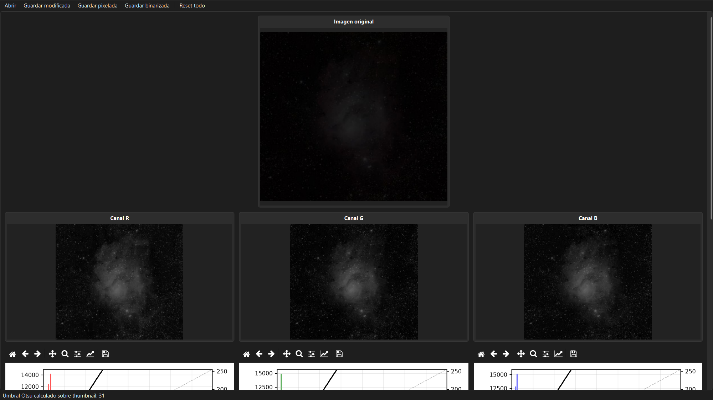

# Ecualización tonal

Aplicación de escritorio para preparar una imagen a color antes de separar el objeto del fondo.

Con mala iluminación o bajo contraste, segmentar directamente falla. La aplicación permite redistribuir los tonos de cada canal de color, ver el histograma y la curva tonal en tiempo real, y obtener una imagen binaria (objeto en blanco, fondo en negro).

Proyecto de Inteligencia Artificial · Universidad Técnica de Ambato



## Cómo funciona

La imagen pasa por cinco etapas:

1. **Separación de canales.** Se trabaja el rojo, el verde y el azul por separado, porque un objeto puede destacar en un canal y perderse en otro.
2. **Estiramiento de contraste.** Con los controles de cada canal se elige el rango de entrada y se estira al rango completo de 0 a 255. Los 256 resultados posibles se calculan una vez en una tabla de búsqueda (LUT) en lugar de píxel por píxel.
3. **Recomposición y pixelado.** Los canales se vuelven a unir y se reduce la resolución, lo que elimina detalles finos que confunden a la segmentación.
4. **Luminancia.** La imagen pasa a escala de grises con la fórmula BT.601: `Y = 0,299·R + 0,587·G + 0,114·B`.
5. **Binarización con Otsu.** El umbral entre objeto y fondo se elige con el método de Otsu, probando los 256 cortes posibles.

La ecuación del contraste, la tabla de búsqueda, la fórmula de luminancia y el método de Otsu están programados a mano con NumPy, sin usar las funciones equivalentes de OpenCV. `análsis.md` explica cada etapa con más detalle.

## Estructura

| Carpeta | Contenido |
|---|---|
| `core/` | Histograma, curva tonal, redistribución y el pipeline completo |
| `gui/` | Ventana principal en PySide6: visor de imagen, paneles por canal, curva e histograma |
| `utils/` | Conversión entre arreglos de NumPy e imágenes de Qt |

## Ejecutar

Requisitos: Python 3.10 o superior.

```bash
pip install -r requirements.txt
python main.py
```

## Equipo

Sebastián Constante y Pablo Montero.
